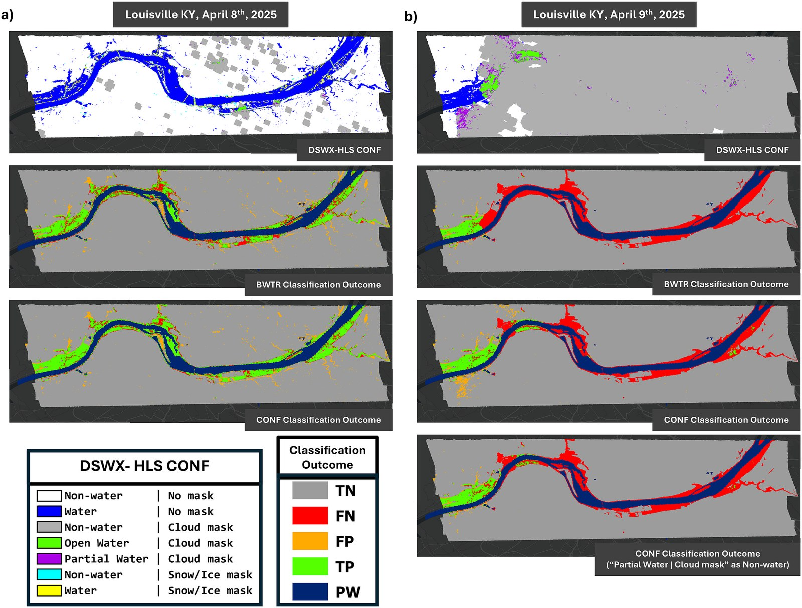

# dswx-flood-enhance

Code and data to reproduce the results of

> Do, S.K., Munasinghe, D., Tian, D., Cohen, S., Eylander, J., Crisanti, S., Tran, D., Lakshmi, V. (2027).
> Under cloud and canopy: enhancing the Dynamic Surface Water eXtent - Harmonized Landsat Sentinel-2
> (DSWx-HLS) flood maps with terrain-based flood propagation. *ISPRS Journal of Photogrammetry and Remote
> Sensing* 243, 840-858. https://doi.org/10.1016/j.isprsjprs.2026.10.045

The study evaluates NASA OPERA's DSWx-HLS (and USGS Landsat DSWE) flood maps against hand-labelled NOAA
aerial-photo benchmarks for two U.S. floods - Louisville, KY (April 2025) and Hurricane Harvey in Sugar Land, TX
(September 2017) - and tests two terrain-based methods, FLEXTH and RS-FloodXdepth, for recovering flooding hidden
under clouds and canopy.

<p align="center">
  
  <br><em>Fig. 7 of the paper: DSWx-HLS BWTR and CONF layers vs. the aerial benchmark, Louisville, April 2025.
  Reproduced from Do et al. (2027), © 2026 ISPRS, published by Elsevier B.V.</em>
</p>

## Quick start

Requires [Miniconda](https://docs.conda.io/en/latest/miniconda.html). Tested on Windows 11.

```bash
git clone https://github.com/skd862/dswx-flood-enhance.git
cd dswx-flood-enhance
conda env create -f environment.yml      # once, ~3-6 min
conda activate dswx-flood-enhance
python run_all.py                        # all steps, ~4 min, offline
```

Results are written to `outputs/results/`, figures to `outputs/figures/`. Each step is also available as a
Jupyter notebook (`01_prepare_inputs.ipynb`, ...).

*Troubleshooting:* if `import cv2` fails with "DLL load failed", recreate the environment from
`environment.yml` (it must not mix in Anaconda `defaults` packages). On Windows, clone into a short path
(e.g. `C:\work\`) - some file names are long.

## What it does

| Step | Content |
|---|---|
| `01_prepare_inputs.py` | builds initial flood maps, exclusion and permanent-water masks and DTMs from the DSWx-HLS / DSWE products |
| `02_flexth.py` | FLEXTH, 18 runs (3 cases x 3 initial flood maps x 2 DEMs) |
| `03_rsfloodxdepth.py` | RS-FloodXdepth, 18 runs (see below) |
| `04_evaluate.py` | BA, CSI, F1, precision, recall and agreement maps - **Tables 2 and 3** |
| `05_figures.py` | map figures (Figs. 1c, 3, 4, 5, 7, 9, 10, 11; simplified matplotlib versions) |

All paths, class codes and parameter values are in `config.py`; the parameters are explained in
`02_FLEXTH_parameters.md` and `03_RSFloodXdepth_parameters.md`. Permanent water is excluded from every
evaluation, as in the paper.

**Checking your run:** `04_evaluate.py` prints each table next to the published values, and
`outputs/results/comparison_with_paper.csv` lists the differences. Table 2 is reproduced exactly and Table 3
to within 0.01 for 31 of 36 rows (largest difference 0.05; see `02_FLEXTH_parameters.md`). `expected_results/`
contains the output of a full run for comparison.

**RS-FloodXdepth:** the code of this method belongs to its developers and is not included. By default step 03
uses its flood maps produced for the paper (`data/precomputed/rsfloodxdepth/`), so all tables and figures are
still reproduced. If you obtain the code from the developers, see `third_party/rsfloodxdepth/README.md` to run it.

## Data

All inputs are included in `data/`:

* **Satellite products** - OPERA DSWx-HLS v1.0 (NASA PO.DAAC), USGS Landsat C2 DSWE, HLS v2.0 composites for
  the figures.
* **Benchmarks** - hand-labelled NOAA aerial flood maps from [FIMbench](https://fimbench.streamlit.app/)
  (Surface Dynamics Modeling Lab, University of Alabama).
* **DEMs** - FABDEM (Hawker et al., 2022) and USGS 3DEP, 30 m Google Earth Engine exports.
* **Other** - JRC Global Surface Water permanent water (Louisville), USGS gauge 03294500, study-area outlines.

`python 01_prepare_inputs.py --download` re-downloads the satellite products (needs a free NASA Earthdata
account; see the script header).

## Citation

If you use this code or data, please cite the paper:

```bibtex
@article{Do2027DSWxFlood,
  author  = {Do, Son Kim and Munasinghe, Dinuke and Tian, Dan and Cohen, Sagy and Eylander, John and
             Crisanti, Sydney and Tran, Duc and Lakshmi, Venkataraman},
  title   = {Under cloud and canopy: enhancing the Dynamic Surface Water eXtent - Harmonized Landsat
             Sentinel-2 ({DSWx-HLS}) flood maps with terrain-based flood propagation},
  journal = {ISPRS Journal of Photogrammetry and Remote Sensing},
  volume  = {243},
  pages   = {840--858},
  year    = {2027},
  doi     = {10.1016/j.isprsjprs.2026.10.045}
}
```

and the flood-propagation methods:

* **FLEXTH** - Betterle, A. & Salamon, P. (2024). Water depth estimate and flood extent enhancement for
  satellite-based inundation maps. *Natural Hazards and Earth System Sciences* 24, 2817-2836.
  https://doi.org/10.5194/nhess-24-2817-2024
* **RS-FloodXdepth** - Tian, D., Liu, H., Wang, L., Cohen, S. & Mandal, T. (2026). *Water Resources Research*
  62, e2025WR042384. https://doi.org/10.1029/2025WR042384

## Licence

* Code of this repository: MIT (`LICENSE`).
* FLEXTH code in `02_flexth.py`: © European Union, EUPL v1.2 (`third_party/`).
* FABDEM-derived DEMs: CC BY-NC-SA 4.0 (non-commercial; contains modified Copernicus WorldDEM-30 data).
  Other data: see each provider's terms.

Questions and problems: please open an [issue](https://github.com/skd862/dswx-flood-enhance/issues).
