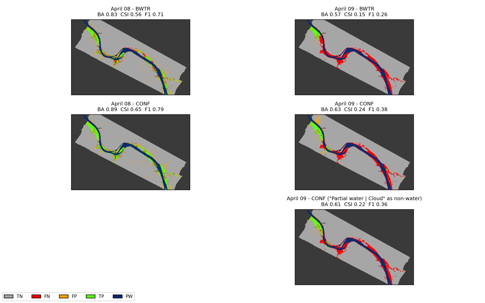

# dswx-flood-enhance

**Enhancing DSWx-HLS flood maps under cloud and canopy with terrain-based flood propagation** - code and data
to reproduce the results of

> Do, S.K., Munasinghe, D., Tian, D., Cohen, S., Eylander, J., Crisanti, S., Tran, D., Lakshmi, V. (2027).
> Under cloud and canopy: enhancing the Dynamic Surface Water eXtent - Harmonized Landsat Sentinel-2
> (DSWx-HLS) flood maps with terrain-based flood propagation. *ISPRS Journal of Photogrammetry and Remote
> Sensing* 243, 840-858. https://doi.org/10.1016/j.isprsjprs.2026.10.045

The study evaluates NASA OPERA's **DSWx-HLS** surface-water product (and the USGS Landsat **DSWE** product)
against hand-labelled NOAA aerial-photo flood maps for two U.S. floods - the Ohio River at **Louisville, KY**
(April 2025) and Hurricane Harvey in **Sugar Land, TX** (September 2017) - and tests two terrain-based methods,
**FLEXTH** and **RS-FloodXdepth**, for recovering flooding hidden under clouds and tree canopy.

<p align="center">
  
  <br><em>DSWx-HLS vs. the aerial benchmark, Louisville (green: true positive, red: false negative,
  orange: false positive, dark blue: permanent water). Produced by this repository.</em>
</p>

**At a glance**

* Reproduces **Table 2** (DSWx-HLS / DSWE accuracy), **Table 3** (FLEXTH and RS-FloodXdepth: 3 initial flood
  maps x 2 DEMs x 3 cases = 36 runs) and the map figures of the paper.
* All data needed are included - runs **offline** in about **4 minutes**, with ~4 GB of free RAM.
* Tested on **Windows 11** with conda-forge packages.
* Table 2 is reproduced exactly; Table 3 to within 0.01 for 31 of 36 rows (largest difference 0.05, explained in
  [Section 5](#5-how-close-are-the-results)).
* The **RS-FloodXdepth code is not included** (it belongs to its developers); its flood maps for the paper are,
  so every table and figure is still reproduced - see [RS-FloodXdepth](#rs-floodxdepth).

**Contents**

1. [Quick start](#1-quick-start)
2. [Check your run](#2-check-your-run)
3. [Repository layout and scripts](#3-repository-layout-and-scripts)
4. [From the paper to the code](#4-from-the-paper-to-the-code)
5. [How close are the results?](#5-how-close-are-the-results)
6. [Differences between the paper text and the code](#6-differences-between-the-paper-text-and-the-code)
7. [How the inputs are built](#7-how-the-inputs-are-built)
8. [Data](#8-data)
9. [Re-downloading the source data (optional)](#9-re-downloading-the-source-data-optional)
10. [How to cite](#10-how-to-cite)
11. [Licences and credits](#11-licences-and-credits)

---

## 1. Quick start

You need [Miniconda](https://docs.conda.io/en/latest/miniconda.html) (or Anaconda) and this repository:
`git clone https://github.com/skd862/dswx-flood-enhance.git`, or **Code -> Download ZIP** on GitHub. Open an **Anaconda Prompt** (or any terminal where
`conda` works) in the repository folder, then:

```bash
conda env create -f environment.yml      # once, ~3-6 min
conda activate dswx-flood-enhance
python run_all.py                        # runs steps 01 -> 05, ~4 min
```

Results go to `outputs/results/`, figures to `outputs/figures/`.

* **Notebooks:** each step is also available as a notebook (`01_prepare_inputs.ipynb`, ...); run them in order
  from the repository folder (`jupyter lab`). The `.py` files are the source; `python tools/make_notebooks.py`
  regenerates the notebooks from them.
* **Troubleshooting - unzipping fails ("path not found" / "path too long"):** some file names are long (up to
  ~150 characters inside the repository) and Windows limits full paths to 260 characters. Unzip / clone into a
  short folder such as `C:\work\`.
* **Troubleshooting - `ImportError: DLL load failed while importing cv2`:** the environment mixed packages from
  the Anaconda `defaults` channel with conda-forge. `environment.yml` prevents this with `nodefaults`; if you
  built the environment another way, recreate it: `conda env remove -n dswx-flood-enhance`, then the two
  commands above.

## 2. Check your run

* `04_evaluate.py` prints Table 2 and Table 3 next to the published values and ends with a one-line summary:
  `Published rows reproduced within 0.01: 43/48; within 0.02: 44/48; largest difference: 0.05`.
* `outputs/results/comparison_with_paper.csv` has one line per published row: the published value
  (e.g. `CSI_paper`), the reproduced value (`CSI`) and their difference (`dCSI`) for each metric, plus
  `max_abs_diff`.
* `expected_results/` holds the tables, comparison and figures of a full run, so you can compare your run with
  it - or browse the results without running anything.

## 3. Repository layout and scripts

```
01_prepare_inputs.py ... 05_figures.py   the five steps (+ .ipynb versions); run_all.py runs them in order
config.py                                every path, class code and parameter value (scripts hard-code nothing)
common.py                                raster I/O, DEM warping, evaluation metrics
02_FLEXTH_parameters.md                  FLEXTH parameters: meaning, defaults, values used
03_RSFloodXdepth_parameters.md           RS-FloodXdepth parameters: meaning, values used
data/source/                             satellite products as downloaded (DSWx-HLS, DSWE, HLS)
data/ancillary/                          benchmarks, DEMs, AOIs, permanent water, gauge data
data/precomputed/rsfloodxdepth/          RS-FloodXdepth flood maps of the paper (used by step 03)
reference/                               Tables 2 and 3 as published
expected_results/                        tables, comparison and figures of a full run
third_party/                             FLEXTH licence and notice; place for the RS-FloodXdepth code
tools/make_notebooks.py                  regenerates the notebooks from the .py files
```

| Step | What it does | Runtime |
|---|---|---|
| `01_prepare_inputs.py` | mosaics / clips the DSWx-HLS (Louisville) and DSWE (Sugar Land) layers; builds the initial flood maps, exclusion masks, permanent-water masks and DTMs | < 1 min |
| `02_flexth.py` | FLEXTH (algorithm + runner) for the 18 FLEXTH runs | ~2 min |
| `03_rsfloodxdepth.py` | RS-FloodXdepth for the 18 runs (precomputed flood maps by default, see below) | seconds |
| `04_evaluate.py` | BA, CSI, F1, precision, recall and agreement maps; comparison with the published tables | < 1 min |
| `05_figures.py` | Figs. 1c, 3, 4, 5, 7, 9, 10, 11 (matplotlib re-creations of the map panels) | < 1 min |

**Outputs**

| File | Content |
|---|---|
| `outputs/results/table2_dswx.csv` | Table 2 (incl. class-specific "Open / Partial water \| Cloud mask" rows) |
| `outputs/results/table3_enhancement.csv` | Table 3 |
| `outputs/results/comparison_with_paper.csv` | every published row next to the reproduced value |
| `outputs/results/agreement/<case>/*.tif` | agreement maps: 0 TN, 1 FN, 2 FP, 3 TP, 10 permanent water, 255 not evaluated |
| `outputs/runs/<case>/<method>/<seed>_<dem>/` | FLEXTH `WE_*.tif` (extent) / `WD_*.tif` (depth); RS-FloodXdepth `FloodClass.tif` |
| `outputs/inputs/<case>/` | inputs written by step 01 |
| `outputs/figures/` | figures |

### RS-FloodXdepth

RS-FloodXdepth is described in Tian, D., Liu, H., Wang, L., Cohen, S. & Mandal, T. (2026), *Water Resources
Research* 62, e2025WR042384, https://doi.org/10.1029/2025WR042384. Its code belongs to its developers (Surface
Dynamics Modeling Lab, University of Alabama) and is **not included here**. `03_rsfloodxdepth.py` therefore:

* by default copies the 18 RS-FloodXdepth flood maps produced for the paper (`data/precomputed/rsfloodxdepth/`)
  into `outputs/runs/`, so steps 04-05 reproduce every RS-FloodXdepth result;
* runs the method itself if you have obtained the code from its developers - see
  `third_party/rsfloodxdepth/README.md`.

The parameters used are documented in `03_RSFloodXdepth_parameters.md`.

## 4. From the paper to the code

| Paper | Code | Output |
|---|---|---|
| Sec. 2.1 hand-labelled NOAA benchmarks | `data/ancillary/*/benchmark_*.tif` | - |
| Sec. 2.2 DSWx-HLS BWTR / CONF, DSWE INWAM / INTSM, land cover | `01_prepare_inputs.py` | `outputs/inputs/<case>/scene_*.tif` |
| Sec. 2.3 FABDEM, USGS 3DEP | `data/ancillary/*/`; warped onto each flood grid in `01` | `.../dtm.tif` |
| Sec. 3.1 evaluation (Table 1 metrics, permanent water excluded) | `04_evaluate.py` | `outputs/results/` |
| Sec. 3.2 FLEXTH | `02_flexth.py` + `02_FLEXTH_parameters.md` | `outputs/runs/<case>/flexth/` |
| Sec. 3.3 RS-FloodXdepth | `03_rsfloodxdepth.py` + `03_RSFloodXdepth_parameters.md` | `outputs/runs/<case>/rsfloodxdepth/` |
| Table 2 / Table 3 | `04_evaluate.py` | `table2_dswx.csv`, `table3_enhancement.csv` |
| Figs. 1c, 3, 4, 5, 7, 9, 10, 11 | `05_figures.py` | `outputs/figures/` |

**Names used in the code**

| Code | Paper |
|---|---|
| `louisville_0408`, `louisville_0409` | Louisville, KY - April 8 (Sentinel-2A) and April 9 (Landsat 8) 2025 DSWx-HLS |
| `harvey` | Sugar Land, TX - Hurricane Harvey; Landsat 8 DSWE of Sept 4 2017, aerial benchmark of Sept 3 |
| seed `bwtr` | initial flood map "BWTR" (for DSWE: INWAM, all water classes merged) |
| seed `conf` | initial flood map "CONF" - every water class, including those under the cloud and snow/ice masks |
| seed `conf_no_partial` | "CONF (partial water as non-water)" - "Partial water \| Cloud mask" treated as non-water |
| `fabdem`, `3dep` | FABDEM, USGS 3DEP |
| `rsfloodxdepth` | RS-FloodXdepth |

### Permanent water is excluded from every evaluation

Pixels flagged as **permanent water are removed from both the candidate and the benchmark before any metric is
computed** (Sec. 3.1 of the paper), so the scores measure transient (event) flooding only and no method is
rewarded for "filling in" rivers and lakes. They show as dark blue "PW" in the agreement maps.

| Site | Permanent-water mask used in the evaluation |
|---|---|
| Louisville | **JRC Global Surface Water** permanent water (Google Earth Engine export) - see [Section 6](#6-differences-between-the-paper-text-and-the-code) |
| Sugar Land | **DSWx-HLS land cover class 200** "Water, wetland, mangrove forest" |

Scores are therefore lower than most published flood-mapping scores, which include permanent water (e.g.
Louisville Apr 8 BWTR: BA / CSI / F1 = 0.83 / 0.56 / 0.71 excluding vs. 0.89 / 0.72 / 0.84 including it).

## 5. How close are the results?

* **Table 2:** all 12 rows reproduced exactly.
* **Table 3:** 31 of 36 rows within 0.01 and 32 within 0.02 on every metric; the largest difference is 0.05.
  The differences come from three sources:

| Rows | Reproduced vs. published | Why |
|---|---|---|
| Louisville Apr 8, FLEXTH, CONF and CONF-no-partial seeds (4 rows) | CSI 0.64-0.65 / F1 0.78-0.79 vs. 0.60-0.61 / 0.75 | in the paper these 4 rows were scored with the DSWx land-cover class-200 permanent-water mask; here every Louisville row uses the same JRC mask (Section 6) |
| Louisville FLEXTH, BWTR + FABDEM (2 rows) | within 0.02 (Apr 8) and 0.01 (Apr 9) | the original runs used S_max = 1, A_g = 1 km²; here every FLEXTH run uses the defaults 0.1 / 0.1 (Section 6) |
| a few Louisville rows with the 3DEP DEM | within 0.01 | re-warping the 3DEP export with today's GDAL gives elevations 9 mm different on average (max 0.35 m) from the original DTMs. The 3DEP rows may also differ by a few hundred pixels from `expected_results/` on other machines / library builds; rounded to 2 decimals they are the same |

The conclusions of the paper do not change.

**Reading the outputs**

* The benchmark is resampled (nearest neighbour) onto each candidate's 30 m grid inside `04_evaluate.py`; the
  Louisville benchmark is included at its ~10 m labelling resolution, the Sugar Land one already at 30 m.
* Class-specific rows of Table 2 ("Open / Partial water \| Cloud mask") are computed only over pixels of that
  class, which are all predicted as water - so recall is 1 and BA 0.5 by construction (shown as "-" in the
  paper); precision (= CSI there) is the meaningful number.

**Not reproduced:** Figs. 2 and 8 (need the multi-GB NOAA aerial mosaics), Fig. 6 (diagram), the supplementary
parameter-sensitivity sweeps, and statistics quoted only in the text (e.g. % of false negatives under cloud or
forest). The FLEXTH sweeps can be re-run by changing `FLEXTH_CASE` in `config.py`.

## 6. Differences between the paper text and the code

A few details of the original analysis are described slightly differently (or more briefly) in the paper.
They are minor, and the code reproduces what was actually run:

1. **Permanent-water mask, Louisville.** The paper (Sec. 2.2) names DSWx-HLS land-cover class 200 as the
   permanent-water layer. For Louisville, the evaluation actually used the **JRC Global Surface Water**
   permanent-water mask, except for the 4 Apr-8 FLEXTH CONF / CONF-no-partial rows, which were scored with
   class 200. This repository scores every Louisville row with JRC, for consistency - which is the 0.04-0.05
   difference on those 4 rows (Section 5). Sugar Land uses class 200 throughout, as in the paper.
   As FLEXTH *input* (`permanent_water.tif`), the Louisville BWTR runs got JRC and the CONF runs class 200,
   as in the original runs.
2. **FLEXTH border smoothing.** The paper (Sec. 3.2) describes a 3 x 3 moving-average filter on the border
   elevations; FLEXTH v1.3, which was used unchanged, applies a 5 x 5 window (`kernel_2` in `02_flexth.py`).
   The published results were produced with the 5 x 5 window, so this does not affect any number.
3. **FLEXTH default parameters.** The paper (Sec. 3.2) states that FLEXTH's default parameters were used,
   apart from D_max and A_1/2. This holds for 34 of the 36 runs; the two Louisville BWTR + FABDEM runs used
   S_max = 1 and A_g = 1 km². Here all runs use the defaults (effect <= 0.02, Section 5).

## 7. How the inputs are built

(`01_prepare_inputs.py`.) Class codes follow the OPERA DSWx-HLS Product Specification (JPL D-107395 Rev B,
v1.0.1, Table 4-1) and the USGS Landsat Collection 2 Level-3 DSWE Data Format Control Book (LSDS-2042 v3.0).

**DSWx-HLS CONF** (0 not water, 1 open water high-confidence, 2 open water moderate-confidence, 3 partial
surface water conservative, 4 partial surface water aggressive; +10 where Fmask flags cloud, cloud shadow or
adjacent to cloud/cloud shadow; +20 where Fmask flags snow/ice) is collapsed as in Fig. 3 of the paper:

| Code | Meaning |
|---|---|
| 0 | not water |
| 1 | water (classes 1-4, not masked) |
| 10 | not water \| cloud |
| 11 | open water \| cloud (11-12) |
| 12 | partial surface water \| cloud (13-14) |
| 20 | not water \| snow/ice |
| 21 | water \| snow/ice (21-24) |

**DSWx-HLS BWTR:** 1 water (open or partial surface water), 252 snow/ice, 253 cloud/cloud shadow and adjacent
to cloud/cloud shadow.

**DSWE (Sugar Land):** **INWAM** (interpreted layer with all masks applied) plays the role of BWTR - classes 1-4
(water high / moderate confidence, partial surface water conservative / aggressive) -> water, 9 (cloud, cloud
shadow) -> 253. **INTSM** (interpreted layer with some masks applied - terrain/hillshade, snow and land cover,
but not cloud) plays the role of CONF: outside the INWAM cloud mask classes 1-4 -> 1; inside it 0 -> 10,
1 -> 11, 3-4 -> 12, and 2 -> 0 (see note 3 below).

| Layer | Louisville BWTR runs | Louisville CONF runs | Sugar Land (all seeds) |
|---|---|---|---|
| flood (seed) | BWTR = 1 | CONF in {1, 11, 12, 21} (`conf_no_partial`: {1, 11, 21}) | INWAM water = 1; CONF in {1, 11, 12} (`conf_no_partial`: {1, 11}) |
| exclusion (FLEXTH) | BWTR 253 + forest (land cover 201) where BWTR = 0 | CONF cloud classes (10-12) + forest | INWAM 9 + forest |
| permanent water (FLEXTH input) | JRC | land cover 200 | land cover 200 |
| permanent water (excluded from evaluation) | JRC | JRC | land cover 200 |
| DTM | FABDEM / 3DEP, bilinear onto the 30 m flood grid | same | same |

RS-FloodXdepth uses only the seed (nodata -> 0) and the DTM; it has no exclusion mask (Sec. 4.3 of the paper).

**Settings worth knowing.** These run-specific choices of the original analysis are reproduced and marked
`NOTE (as published)` in the code:

1. **FLEXTH permanent-water input, Louisville** - BWTR runs get the JRC mask, CONF runs DSWx land-cover class
   200 (the evaluation always uses JRC). See `02_FLEXTH_parameters.md`.
2. **RS-FloodXdepth `k_neighbors`, Sugar Land** - 1 / 4 / 3 for the BWTR / CONF / CONF-no-partial seeds. See
   `03_RSFloodXdepth_parameters.md`.
3. **Sugar Land CONF (INTSM)** - inside the INWAM cloud/cloud-shadow mask, INTSM class 2 ("Water - moderate
   confidence") is coded as not water: on the Landsat image these pixels were all cloud shadow (38,719 of
   ~747,000 masked pixels). Outside the mask class 2 is water, as in INWAM.
4. **Extents / grids** - Louisville BWTR runs use the footprint of the aerial mosaic (`aoi_bwtr_runs.shp`),
   CONF runs the analysis AOI (`aoi_analysis.shp`); both lie on the native DSWx 30 m UTM 16N grid. For the
   BWTR runs forest is added to the exclusion mask only where BWTR is "not water".

**Sugar Land intermediates.** Three Sugar Land layers were made with interactive GIS steps that cannot be
re-executed bit-for-bit in Python (ArcGIS "Clip Raster" resampled INTSM to ~30.15 m). They are included in
`data/ancillary/harvey/paper_intermediates/` and used by default (`HARVEY_EXACT = True` in `config.py`).
With `HARVEY_EXACT = False` everything is rebuilt from the raw tiles in Python; the rebuilt layers agree with the
published ones at 99.97 % (INWAM), ~94 % (INTSM) and ~97 % (land cover), and Table 2 and the FLEXTH rows of
Table 3 then move by <= 0.02. (RS-FloodXdepth is more sensitive to such small changes in the seed map - up to
0.16 for the CONF-no-partial seed - which is one reason the exact intermediates are used by default.)

Louisville is always rebuilt from the raw DSWx-HLS tiles; all Louisville flood, exclusion and permanent-water
rasters and the FABDEM DTMs are bit-identical to the original inputs (3DEP DTMs: see Section 5).

## 8. Data

Everything is in `data/`:

| Folder | Content | Source |
|---|---|---|
| `source/louisville/dswx_hls/` | OPERA DSWx-HLS v1.0 B02_BWTR, B03_CONF, B07_LAND, tiles 16SEH + 16SFH, 2025-04-08 (S2A) and 2025-04-09 (L8) | NASA PO.DAAC, `OPERA_L3_DSWX-HLS_V1` |
| `source/harvey/dswe/` | USGS Landsat C2 L3 DSWE, INWAM (h017 v016/v017) + INTSM (h017 v017), 2017-09-04 | USGS LandsatLook STAC `landsat-c2l3-dswe` |
| `source/harvey/dswx_land/` | DSWx-HLS B07_LAND tiles of January 2025 (land cover for Sugar Land; DSWx-HLS is not available for 2017) | NASA PO.DAAC |
| `source/*/hls/` | HLS SWIR1-NIR-Red composites, only used for Figs. 3-4 | NASA LP DAAC (HLSS30 / HLSL30 v2.0) |
| `ancillary/*/benchmark_*.tif` | hand-labelled NOAA aerial flood maps (1 flood, 0 dry, 255 no data) | Surface Dynamics Modeling Lab, Univ. of Alabama - [FIMbench](https://fimbench.streamlit.app/) (aerial photos: https://storms.ngs.noaa.gov/) |
| `ancillary/*/fabdem_30m_gee.tif` | FABDEM V1-2 (30 m), clipped on its native grid | Google Earth Engine export of `projects/sat-io/open-datasets/FABDEM` (Hawker et al., 2022) |
| `ancillary/*/3dep_30m_gee.tif` | USGS 3DEP aggregated to 30 m, clipped on its native grid | Google Earth Engine export of USGS 3DEP |
| `ancillary/louisville/permanent_water_jrc_gee.tif` | permanent-water mask (Louisville) | JRC Global Surface Water (Pekel et al., 2016), Google Earth Engine export |
| `ancillary/louisville/*.shp` | AOIs (see "Extents / grids" in Section 7) | - |
| `ancillary/louisville/usgs_03294500_gauge_height_2025-04.csv` | gauge height, Fig. 1c | USGS NWIS |
| `ancillary/harvey/paper_intermediates/` | three Sugar Land intermediates exactly as used in the paper | made from `source/harvey` |
| `precomputed/rsfloodxdepth/` | RS-FloodXdepth flood maps (`FloodClass.tif`) of the 18 runs | produced for the paper (see [RS-FloodXdepth](#rs-floodxdepth)) |

## 9. Re-downloading the source data (optional)

Not needed to run the code. `python 01_prepare_inputs.py --download` re-fetches the source products before
processing. It needs extra packages (`conda install -c conda-forge earthaccess pystac-client requests
earthengine-api`) and your own free accounts:

* **NASA Earthdata** (DSWx-HLS, HLS): register at https://urs.earthdata.nasa.gov/. `earthaccess.login()` reads
  `~/.netrc` (Windows: `%USERPROFILE%\_netrc`) with the line
  `machine urs.earthdata.nasa.gov login <user> password <password>`, or the environment variables
  `EARTHDATA_USERNAME` / `EARTHDATA_PASSWORD`, or asks interactively.
* **USGS** (DSWE): searching the LandsatLook STAC needs no login; if the download is refused (HTTP 401/403),
  create an account at https://ers.cr.usgs.gov/ and download the item from https://landsatlook.usgs.gov/ or
  EarthExplorer (product "Landsat C2 Science Products - Dynamic Surface Water Extent").
* **DEMs** (included ready to use; `download_dems()` in `01_prepare_inputs.py`): FABDEM from Google Earth
  Engine, asset `projects/sat-io/open-datasets/FABDEM` (https://gee-community-catalog.org/projects/fabdem/; needs
  a GEE account and `earthengine authenticate`); USGS 3DEP from The National Map
  (https://apps.nationalmap.gov/downloader/) or the GEE collection `USGS/3DEP/1m`.
* **Permanent water, Louisville**: JRC Global Surface Water (Pekel et al., 2016; in GEE, e.g.
  `JRC/GSW1_4/GlobalSurfaceWater`); the included export is the one used in the paper.
* The hand-labelled benchmarks are distributed through FIMbench (https://fimbench.streamlit.app/).

## 10. How to cite

If you use this code or data, please cite the paper (GitHub's **Cite this repository** button gives the same
reference, from `CITATION.cff`):

```bibtex
@article{Do2027DSWxFlood,
  author  = {Do, Son Kim and Munasinghe, Dinuke and Tian, Dan and Cohen, Sagy and Eylander, John and
             Crisanti, Sydney and Tran, Duc and Lakshmi, Venkataraman},
  title   = {Under cloud and canopy: enhancing the Dynamic Surface Water eXtent - Harmonized Landsat
             Sentinel-2 ({DSWx-HLS}) flood maps with terrain-based flood propagation},
  journal = {ISPRS Journal of Photogrammetry and Remote Sensing},
  volume  = {243},
  pages   = {840--858},
  year    = {2027},
  doi     = {10.1016/j.isprsjprs.2026.10.045}
}
```

and the two methods: Betterle, A. & Salamon, P. (2024), *NHESS* 24, 2817-2836 (FLEXTH), and Tian, D., Liu, H.,
Wang, L., Cohen, S. & Mandal, T. (2026), *Water Resources Research* 62, e2025WR042384,
https://doi.org/10.1029/2025WR042384 (RS-FloodXdepth).

## 11. Licences and credits

| Part | Licence / terms |
|---|---|
| Code of this repository (`01`, `03`, `04`, `05`, `config.py`, `common.py`, `run_all.py`, `tools/`) | MIT - see `LICENSE` |
| FLEXTH code in `02_flexth.py` (Betterle & Salamon, © European Union) | EUPL v1.2 - see `third_party/` |
| FABDEM-derived DEMs | CC BY-NC-SA 4.0 (non-commercial; contains modified Copernicus WorldDEM-30 data, © DLR e.V. 2010-2014 and © Airbus Defence and Space GmbH 2014-2018, provided under COPERNICUS by the European Union and ESA) |
| OPERA DSWx-HLS, HLS, USGS DSWE, USGS 3DEP, USGS NWIS gauge data, JRC Global Surface Water | openly available; see each provider's terms |
| Hand-labelled benchmarks | Surface Dynamics Modeling Lab, University of Alabama, distributed through FIMbench; please cite the paper above |

* **FLEXTH** v1.3 (https://code.europa.eu/floods/floods-river/flexth); `02_flexth.py` passes parameters as
  arguments, adds a binary extent output and drops the unused tiling option - the computations are unchanged.
* **RS-FloodXdepth** - Tian et al. (2026); code by the Surface Dynamics Modeling Lab, University of Alabama
  (not included; see [RS-FloodXdepth](#rs-floodxdepth)).
* Repository code: Son Kim Do. Questions and problems: please open an issue at
  https://github.com/skd862/dswx-flood-enhance/issues.
